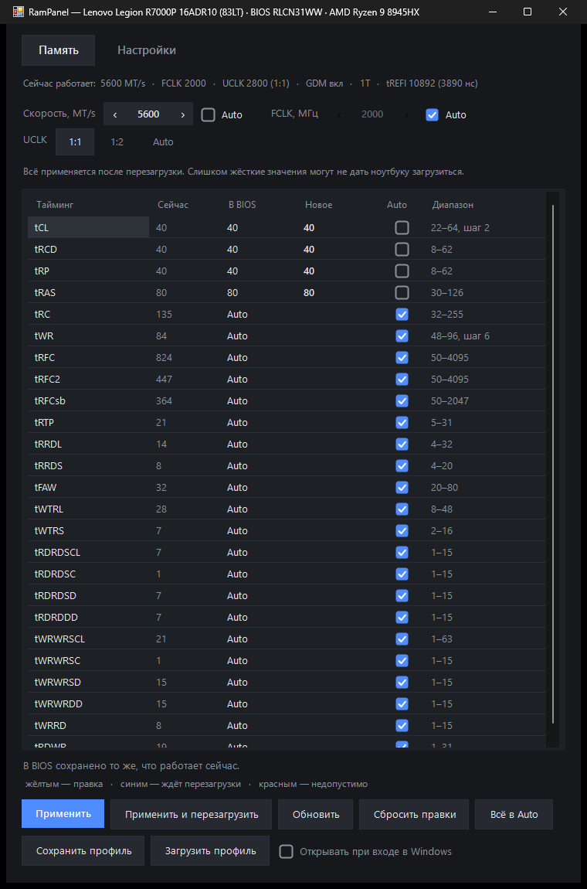

# RamPanel

Окно для ручной настройки таймингов, скорости памяти, FCLK и режима UCLK на компьютерах с AMD Ryzen — из Windows,
без захода в BIOS. Значения записываются в BIOS через штатный интерфейс разгона AMD (тот же, которым пользуется
Ryzen Master) и включаются после перезагрузки.

*A Windows GUI for DDR4/DDR5 timings, memory speed, FCLK and UCLK mode on AMD Ryzen systems, written through AMD's own
overclocking interface (AMD_ACPI WMI). English summary [below](#english).*

> **Это непроверенный в широком смысле проект.** Полностью проверен он только на одном ноутбуке
> (Lenovo Legion R7000P 16ADR10, BIOS RLCN31WW, Ryzen 9 8945HX). Слишком жёсткие тайминги могут не дать компьютеру
> загрузиться, а на многих ноутбуках сброс BIOS возможен только с разборкой корпуса. Всё — на свой риск.

## Что умеет

- все 25 таймингов, которые отдаёт интерфейс разгона AMD (tCL … tRDWR), с допустимыми диапазонами от самого BIOS;
- скорость памяти, FCLK, режим UCLK (1:1 / 1:2 / Auto);
- Auto для любого поля и кнопка «Всё в Auto»;
- показывает, что работает сейчас и что лежит в BIOS и включится после перезагрузки;
- на проверенном устройстве после каждой записи сверяет настройки BIOS байт в байт;
- после перезагрузки сверяет записанное с тем, что реально работает, и предупреждает, если BIOS что-то отклонил или откатил;
- профили, тёмная тема, масштаб 75–200 %, русский и английский.

## Уровни поддержки

RamPanel сам определяет уровень при запуске (вкладка «Настройки» → «Устройство»).

| Уровень | Когда | Что можно |
|---|---|---|
| Проверенное устройство | модель, BIOS и процессор из списка `$Verified` в `src/RamPanel.ps1` | всё, запись сверяется сразу |
| Экспериментальный | любой AMD Ryzen с интерфейсом разгона AMD в BIOS и памятью DDR4/DDR5 | запись только после явного включения галочкой; если формат настроек BIOS незнакомый — проверка только после перезагрузки |
| Только просмотр | нет интерфейса разгона (многие производители ноутбуков его убирают), распаянная LPDDR, не AMD | просмотр работающих таймингов |

Скорее всего подойдут: настольные платы AM4/AM5 и игровые ноутбуки на Ryzen HX (7045HX, 7945HX, 8945HX, 9955HX…)
с отдельными планками DDR5. Обычные тонкие ноутбуки с распаянной памятью — только просмотр.

## Установка

Скачайте `RamPanel-Setup-x.y.z.exe` из Releases (если он там выложен) или соберите сами (ниже). Нужны Windows 10/11 x64
и права администратора — больше ничего ставить не нужно: PowerShell 5.1 и .NET Framework 4 уже есть в Windows,
библиотеки идут в комплекте. Ставится в `%LOCALAPPDATA%\Programs\RamPanel`, удаляется через «Параметры → Приложения».

Если в Windows включена «Изоляция ядра → Целостность памяти», драйвер для чтения таймингов может не загрузиться —
тогда RamPanel сообщит, что не может прочитать тайминги.

## Сборка

1. Положите `ZenStates-Core.dll` и `inpoutx64.dll` в `vendor/` (откуда взять — в [vendor/README.md](vendor/README.md)).
2. `powershell -ExecutionPolicy Bypass -File installer\build.ps1` → `dist\RamPanel-Setup-<версия>.exe`.

Компилятор C# берётся из .NET Framework, который есть в Windows. Запуск из исходников без установки:
`powershell -ExecutionPolicy Bypass -File src\RamPanel.ps1` от имени администратора.
Полезные ключи: `-SelfCheck` (что найдено на этом компьютере), `-Plan "tRAS=74;speed=5600;uclk=1:1"` (что было бы записано,
без записи), `-Set "..."` (записать без окна, с теми же проверками).

## Как это устроено

Подробно — в [docs/HOW-IT-WORKS.md](docs/HOW-IT-WORKS.md): интерфейс AMD_ACPI, команды, формат переменной настроек BIOS,
почему Auto ставится через общий сброс, и как BIOS сам откатывает память после неудачной тренировки (APCB recovery).

## Кто это сделал

Программу написал **Claude** — ИИ от Anthropic (модели Claude Opus 5.5 и Claude Fable 5.2, в Claude Code) — по инициативе
и под руководством человека, которому принадлежит этот репозиторий («кожаного», как он сам себя называет).

Что делал Claude:
- разобрал логику BIOS ноутбука (Insyde, RLCN31WW) — распаковка образа, декомпиляция модулей в Ghidra — чтобы понять,
  где хранятся настройки памяти и как работает откат после неудачной загрузки;
- опытным путём, с откатом каждого шага, выяснил, как ведут себя команды интерфейса разгона AMD на этом BIOS;
- написал саму программу, установщик и проверки, и протестировал их на ноутбуке владельца.

Что делал человек: придумал, что нужно, ставил задачи и ограничения, принимал решения о каждой записи в BIOS и
перезагрузке, проверял всё на своём ноутбуке.

Сторонние компоненты и их лицензии — в [THIRD-PARTY-NOTICES.md](THIRD-PARTY-NOTICES.md).

Проект не связан с AMD или Lenovo; названия — товарные знаки их владельцев.

## Лицензия

GPL-3.0 (см. [LICENSE](LICENSE)) — как и у ZenStates-Core, без которой программа не работает.

---

## English

RamPanel is a small Windows (PowerShell + WinForms) app that reads the running DDR4/DDR5 timings through
ZenStates-Core and writes new timings, memory speed, FCLK and UCLK mode into the BIOS through AMD's overclocking WMI
interface (`root\wmi\AMD_ACPI`, the one Ryzen Master uses). Changes apply after a reboot.

- **Verified** devices (currently one: Lenovo Legion R7000P 16ADR10, BIOS RLCN31WW, Ryzen 9 8945HX) get byte-level
  verification of every write.
- **Experimental** mode for any AMD system whose BIOS exposes the interface and uses socketed DDR4/DDR5: command IDs and
  allowed ranges come from the BIOS itself, writing must be enabled explicitly, unknown BIOS layouts are verified after
  the next reboot only.
- Everything else is read-only.

Too-tight values can leave a machine unable to boot; on many laptops clearing CMOS means opening the case. Use at your
own risk. Built by Claude (Anthropic) at the request of, and under the direction of, the repository owner. GPL-3.0.
